# Pharma Distribution Manager

Gestion de la distribution pharmaceutique — projet **DPCI Atelier GL 19**.

Application web de gestion des commandes, des lots, des dates de péremption, de la traçabilité et de la préparation des livraisons pour un grossiste-répartiteur pharmaceutique.

## Liens utiles

| Ressource | Lien |
|---|---|
| **Maquettes Figma** | [Ouvrir les maquettes DPCI sur Figma](https://www.figma.com/design/opNROc0MskFx7J8W2Gg0uR/DPCI---Maquettes?t=7v5Xy6XDh2vJJUwn-1) |
| **Présentation** | [DPCI_Atelier_GL_19.pptx](https://github.com/christkonanboh-svg/pharma-distribution-manager/releases/download/presentation-dpci-gl19/DPCI_Atelier_GL_19.pptx) |
| **Cahier des charges** | [Cahier_des_charges_DPCI_Atelier_GL19.docx](Cahier_des_charges_DPCI_Atelier_GL19.docx) |

## Maquettes

Les maquettes de l'application sont disponibles sur Figma :

👉 **[Consulter les maquettes DPCI](https://www.figma.com/design/opNROc0MskFx7J8W2Gg0uR/DPCI---Maquettes?t=7v5Xy6XDh2vJJUwn-1)**

Elles couvrent le parcours complet : connexion, tableau de bord, alertes, commandes, préparation FEFO, livraisons, stock et lots, réception, traçabilité, rappel de lot, référentiels et administration.

## Diagrammes UML

Les 16 diagrammes sont versionnés sous forme d'images PNG dans le dossier [`diagrammes-uml/`](diagrammes-uml/). Les sources PlantUML ne sont pas incluses dans ce dépôt : les exports ci-dessous font référence.

### Cas d'utilisation

<p align="center">
  <a href="diagrammes-uml/01_cas_utilisation.png">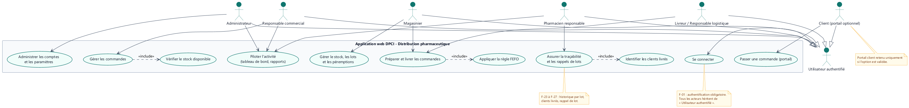</a><br>
  <em>Vue globale des acteurs et des fonctions</em>
</p>

<p align="center">
  <a href="diagrammes-uml/01b_cas_utilisation_commandes.png">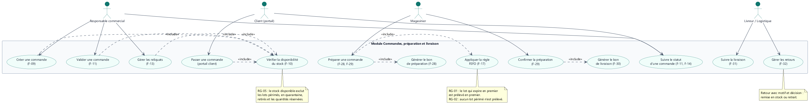</a><br>
  <em>Commandes, disponibilité, préparation et livraison</em>
</p>

<p align="center">
  <a href="diagrammes-uml/01c_cas_utilisation_stock_tracabilite.png">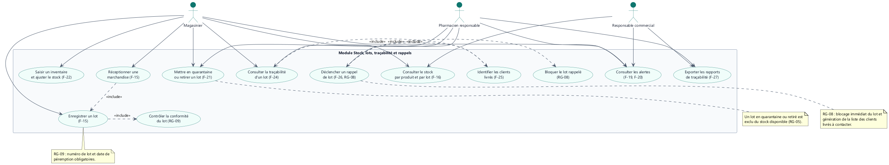</a><br>
  <em>Stock, lots, FEFO, alertes, traçabilité et rappels</em>
</p>

<p align="center">
  <a href="diagrammes-uml/01d_cas_utilisation_administration.png">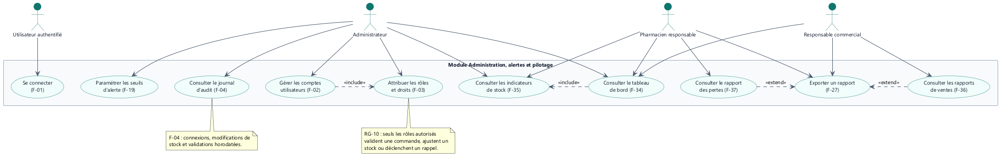</a><br>
  <em>Comptes, rôles, audit et paramètres</em>
</p>

### Classes et modèle de données

<p align="center">
  <a href="diagrammes-uml/02_classes.png">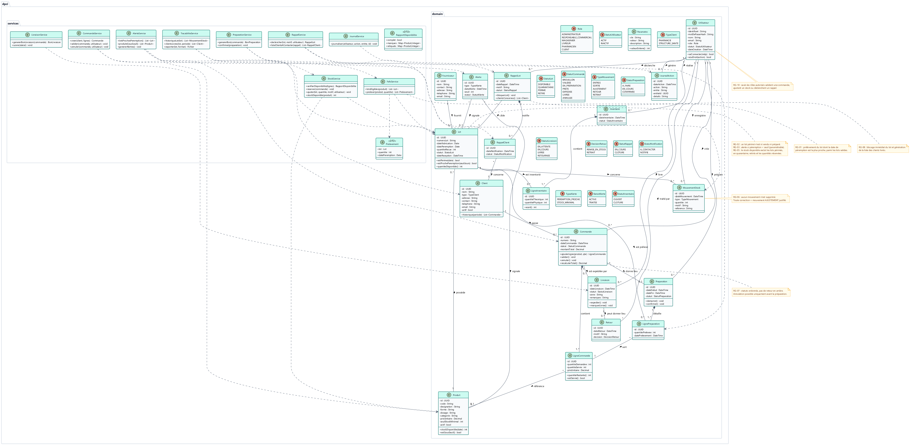</a><br>
  <em>Produit, lot, commande, mouvement de stock, livraison et utilisateur</em>
</p>

<p align="center">
  <a href="diagrammes-uml/13_modele_donnees.png">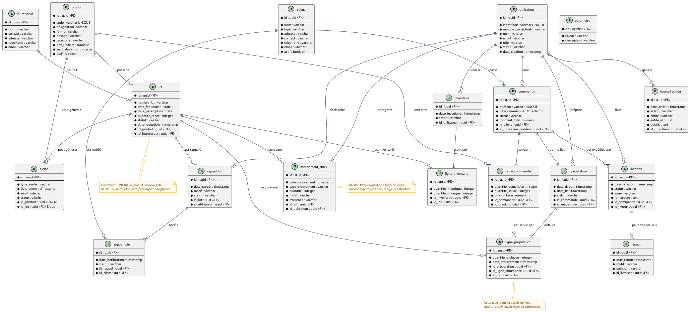</a><br>
  <em>Modèle relationnel et relations principales</em>
</p>

### Séquences

<p align="center">
  <a href="diagrammes-uml/03_sequence_commande.png">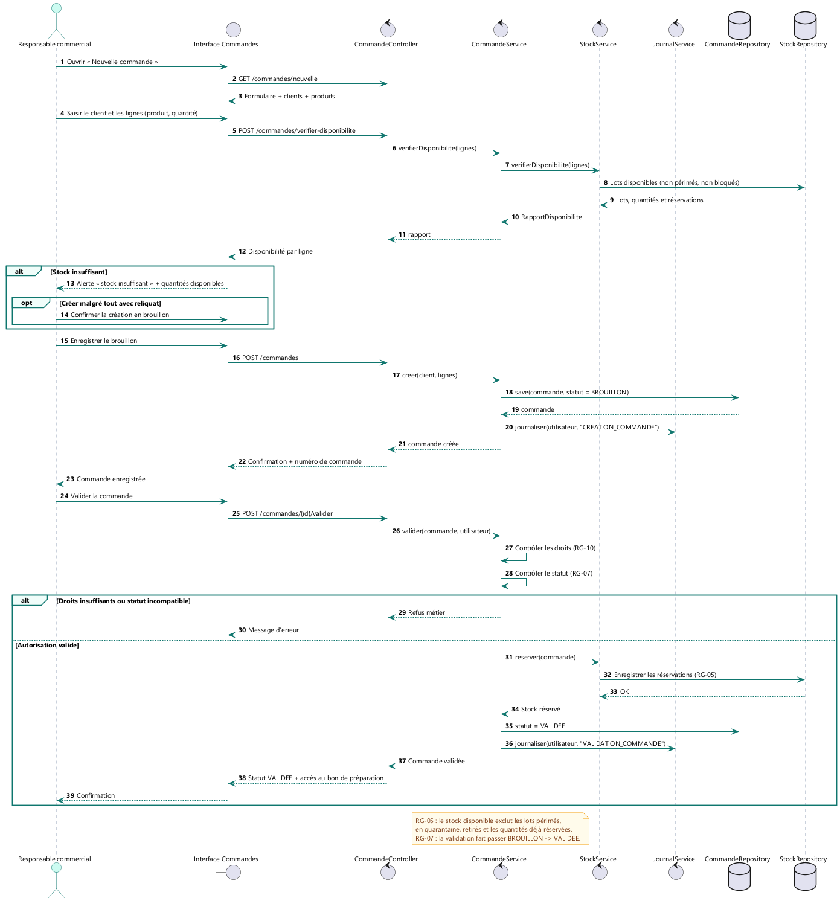</a><br>
  <em>Création et validation d'une commande avec contrôle du stock</em>
</p>

<p align="center">
  <a href="diagrammes-uml/04_sequence_reception_lot.png">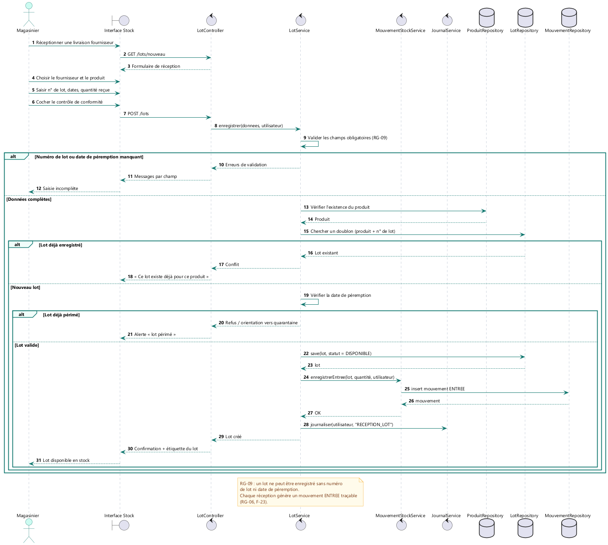</a><br>
  <em>Réception fournisseur, contrôle et entrée en stock</em>
</p>

<p align="center">
  <a href="diagrammes-uml/05_sequence_preparation_fefo.png">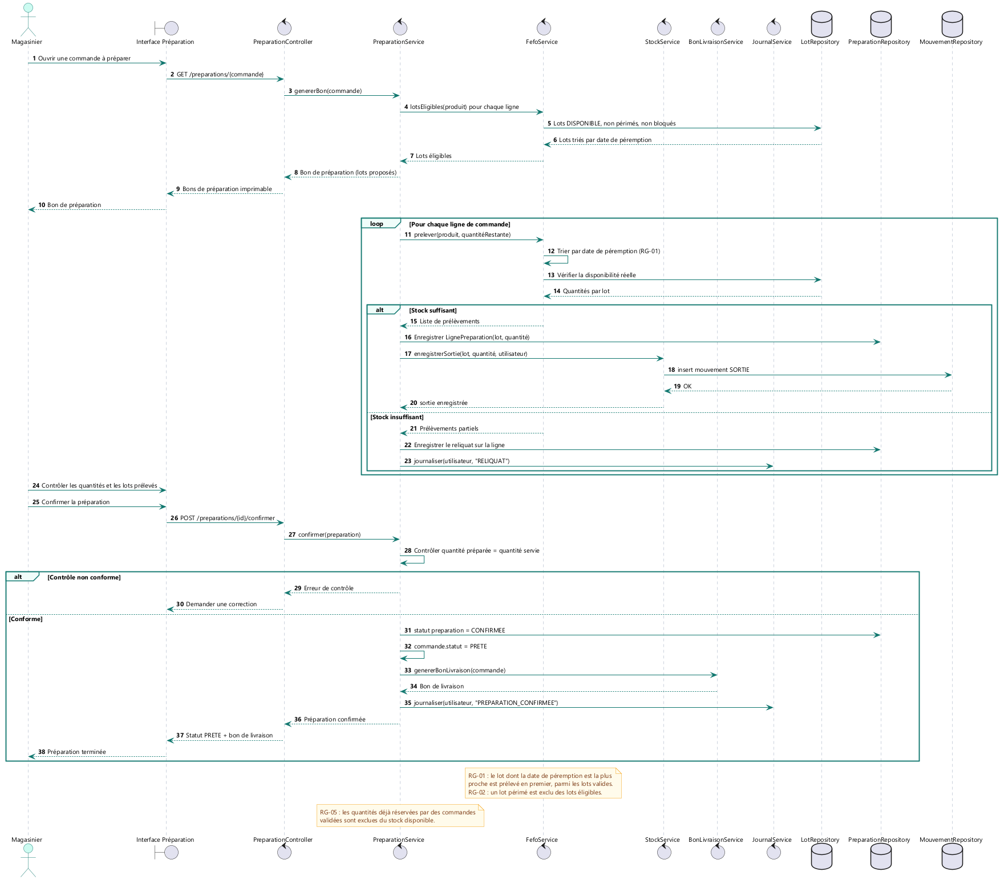</a><br>
  <em>Sélection FEFO des lots, réservation et sortie de stock</em>
</p>

<p align="center">
  <a href="diagrammes-uml/06_sequence_rappel_lot.png">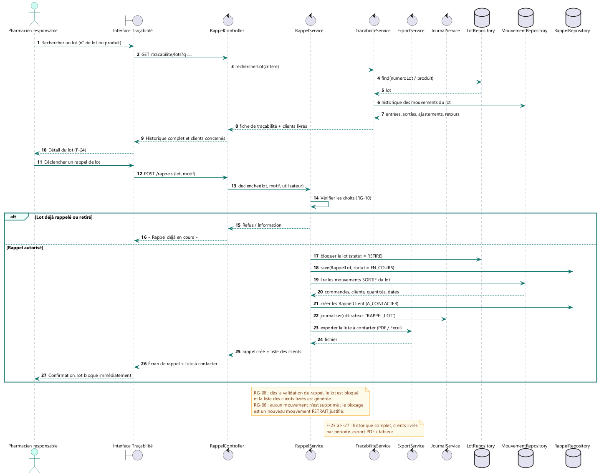</a><br>
  <em>Blocage du lot, identification des clients et notifications</em>
</p>

<p align="center">
  <a href="diagrammes-uml/07_sequence_alertes.png">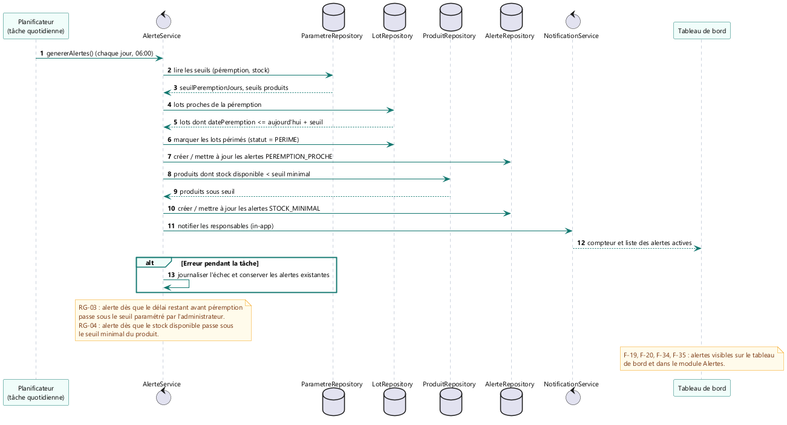</a><br>
  <em>Détection des péremptions et des seuils de stock</em>
</p>

### États et activité

<p align="center">
  <a href="diagrammes-uml/08_etats_commande.png">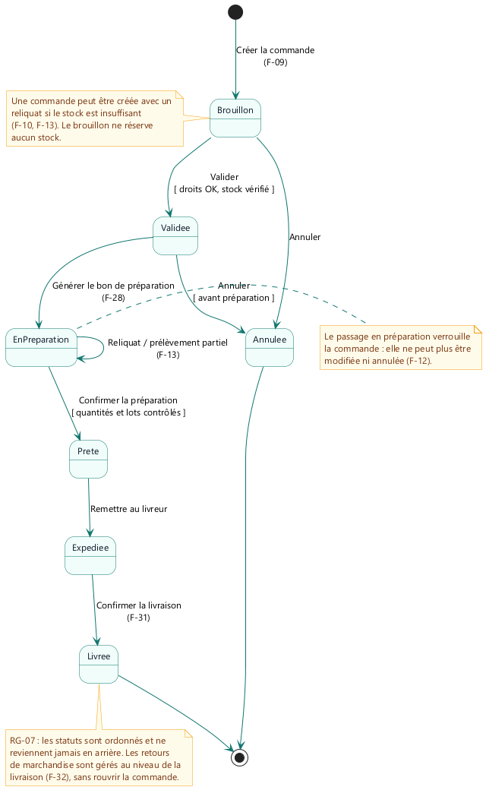</a><br>
  <em>Cycle de vie d'une commande</em>
</p>

<p align="center">
  <a href="diagrammes-uml/09_etats_lot.png">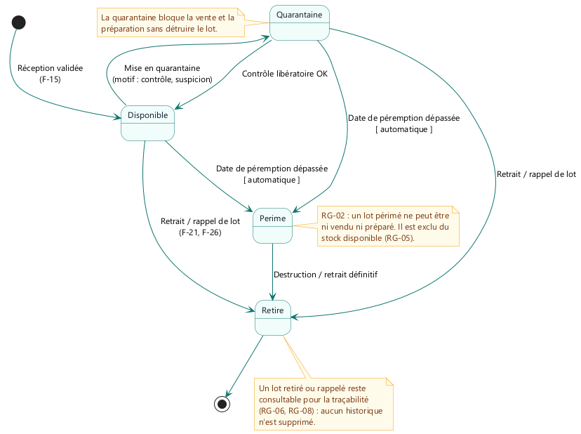</a><br>
  <em>Cycle de vie d'un lot : disponible, quarantaine, périmé, retiré</em>
</p>

<p align="center">
  <a href="diagrammes-uml/10_activite_preparation_fefo.png">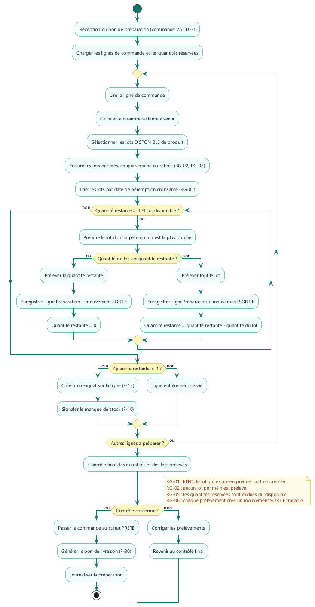</a><br>
  <em>Logique de prélèvement FEFO et gestion du reliquat</em>
</p>

### Architecture

<p align="center">
  <a href="diagrammes-uml/11_composants.png">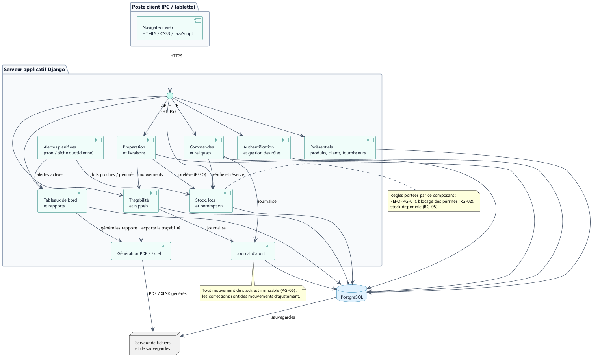</a><br>
  <em>Composants applicatifs</em>
</p>

<p align="center">
  <a href="diagrammes-uml/12_deploiement.png">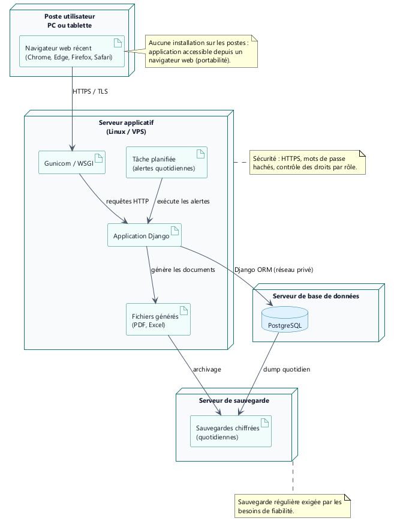</a><br>
  <em>Déploiement cible</em>
</p>

## Présentation du projet

👉 [DPCI_Atelier_GL_19.pptx](https://github.com/christkonanboh-svg/pharma-distribution-manager/releases/download/presentation-dpci-gl19/DPCI_Atelier_GL_19.pptx)

| # | Slide |
|---|---|
| 1 | Digitalisation de la gestion pharmaceutique — DPCI, sujet n°19 |
| 2 | Contexte et enjeux : le grossiste-répartiteur, maillon vital |
| 3 | Présentation de l'entreprise DPCI (création 2000, 4 implantations) |
| 4 | Structure et organisation de la DPCI |
| 5 | Analyse du processus métier : le parcours d'une commande |
| 6 | Problématique |
| 7 | Objectifs du projet |
| 8 | Solution proposée : une application web centralisée |
| 9 | Fonctionnalités principales |
| 10 | Gestion intelligente des stocks — règle FEFO |
| 11 | Traçabilité et sécurité (rôles et droits) |
| 12 | Choix techniques : Django, PostgreSQL, UML, Git |
| 13 | Planning : 13 semaines, 6 phases |
| 14 | Conclusion et perspectives |

## Structure du dépôt

```text
pharma-distribution-manager/
├─ README.md
├─ Cahier_des_charges_DPCI_Atelier_GL19.docx
└─ diagrammes-uml/
   ├─ 01_cas_utilisation.png
   ├─ 01b_cas_utilisation_commandes.png
   ├─ 01c_cas_utilisation_stock_tracabilite.png
   ├─ 01d_cas_utilisation_administration.png
   ├─ 02_classes.png
   ├─ 03_sequence_commande.png
   ├─ 04_sequence_reception_lot.png
   ├─ 05_sequence_preparation_fefo.png
   ├─ 06_sequence_rappel_lot.png
   ├─ 07_sequence_alertes.png
   ├─ 08_etats_commande.png
   ├─ 09_etats_lot.png
   ├─ 10_activite_preparation_fefo.png
   ├─ 11_composants.png
   ├─ 12_deploiement.png
   └─ 13_modele_donnees.png
```

> Les maquettes ne sont pas versionnées dans ce dépôt pour le moment. Elles restent accessibles via le lien Figma ci-dessus.
